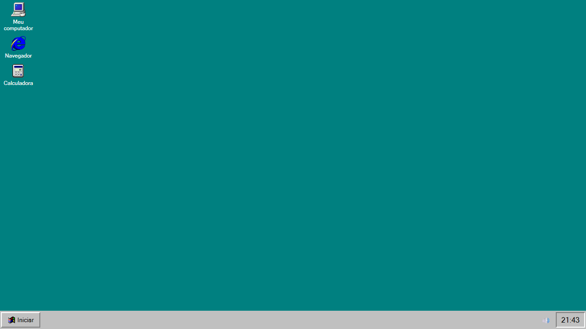

# Jeffersom.net

Projeto de desktop com visual estilo Windows 98, recriando uma experiência de ambiente de sistema com ícones, menu iniciar e programas como navegador, calculadora e meu computador.



## Funcionalidades

- Interface desktop inspirada no Windows 98
- Ícones e menu iniciar
- Janela de navegador
- Calculadora funcional
- Estrutura de páginas e componentes em JavaScript

## Como executar

1. Abra o arquivo `index.html` em um navegador.
2. Ou sirva a pasta localmente com um servidor HTTP, por exemplo:

```bash
python -m http.server 8000
```

Em seguida, acesse `http://localhost:8000`.

## Tecnologias

- HTML
- CSS
- JavaScript
